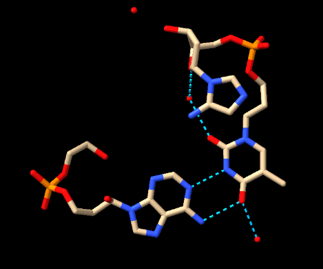

# Scientist’s Mission (0153B006 許淙竤)

## Who Stole TP53’s Superpower? Searching for the Key to Unlock Cancer
### Using AI to Uncover the Secrets of TP53–DNA Interactions

---

### 1. 【The LEGO Assembly Line】
**What type of bond links amino acids together to form a protein? Which amino acids form hydrogen bonds with each other?**

**Answer:**  
連接胺基酸以形成蛋白質的核心化學鍵是**肽鍵（Peptide bond）**。

#### 1. 肽鍵（Peptide Bond）
肽鍵是一種強烈的共價鍵（屬於醯胺鍵的一種）。當一個胺基酸的羧基（`-COOH`）與另一個胺基酸的胺基（`-NH2`）發生縮合反應（脫水反應）時，會釋放一分子水（$	ext{H}_2	ext{O}$），並形成 `-CO-NH-` 的肽鍵連結。

#### 2. 哪些胺基酸之間會形成氫鍵？
在蛋白質中，氫鍵（Hydrogen bond）的形成主要可以分為兩大部分：

* **① 骨架之間的氫鍵（與胺基酸種類無關）**  
  蛋白質的二次結構（如 $lpha$-螺旋 和 $eta$-折疊）主要是透過主鏈骨架上的原子形成氫鍵。主鏈上的羰基氧原子（`C=O`）作為氫鍵受體，與另一個殘基的醯胺氫原子（`N-H`）作為氫鍵供體相互吸引，這與具體是哪一種胺基酸無關。

* **② 側鏈（R基）之間的氫鍵（極性與帶電胺基酸）**  
  蛋白質的三次與四次結構中，具有極性不帶電或帶電荷側鏈的胺基酸可以在側鏈之間形成氫鍵：
  * **極性不帶電側鏈**（含有 `-OH`、`-NH2`、`-CONH2` 基團）：
    * 絲胺酸 (Serine, Ser) & 蘇胺酸 (Threonine, Thr)：含有羥基（`-OH`）
    * 酪胺酸 (Tyrosine, Tyr)：含有酚羥基（`-OH`）
    * 天冬醯胺 (Asparagine, Asn) & 麩醯胺 (Glutamine, Gln)：含有醯胺基（`-CONH2`）
  * **帶電側鏈**（酸性與鹼性胺基酸，亦可形成氫鍵/鹽橋）：
    * 天冬胺酸 (Aspartic acid, Asp) & 麩胺酸 (Glutamic acid, Glu)：羧基（`-COO-`）可作為氫鍵受體
    * 賴胺酸 (Lysine, Lys)、精胺酸 (Arginine, Arg) & 組胺酸 (Histidine, His)：含氮基團可作為氫鍵供體

---

### 2. 【The Double-Track Highway of Life’s Blueprint】
**How do nucleotides assemble to form double-stranded DNA? What are the basic structural components of DNA? Is DNA right-handed or left-handed? List the names of the four DNA bases. Which bases form hydrogen bonds with each other?**

**Answer:**  
DNA（去氧核糖核酸）是儲存遺傳資訊的核心分子，其基本組成與雙螺旋結構如下：

#### 1. DNA 的基本構造組分
DNA 的基本重複單位是**去氧核苷酸（Deoxyribonucleotide）**，每個核苷酸由三個部分組成：
* **去氧核糖（Deoxyribose）：** 五碳糖的一種。
* **磷酸基團（Phosphate group）：** 提供分子骨架的酸性特性。
* **含氮鹼基（Nitrogenous base）：** 接在去氧核糖的 1' 號碳位置。

#### 2. 四種 DNA 鹼基與氫鍵配對
DNA 包含四種含氮鹼基，分為嘌呤（雙環）與嘧啶（單環）兩類：
* 腺嘌呤（Adenine, A）
* 胸腺嘧啶（Thymine, T）
* 鳥糞嘌呤（Guanine, G）
* 胞嘧啶（Cytosine, C）

**鹼基互補配對與氫鍵：**
* **A 與 T 配對：** 形成 2 個氫鍵（$	ext{A} = 	ext{T}$）。
* **G 與 C 配對：** 形成 3 個氫鍵（$	ext{G} \equiv 	ext{C}$）。

#### 3. 核苷酸如何組裝成雙股 DNA？
* **單股延伸（磷酸二酯鍵）：**  
  相鄰核苷酸之間透過強烈的共價鍵——**磷酸二酯鍵（Phosphodiester bond）** 連接。一個核苷酸的 5' 端磷酸基團與另一個核苷酸的 3' 端羥基（`-OH`）反應，形成具方向性（5' 到 3'）的糖-磷酸骨架（Sugar-phosphate backbone）。
* **雙股形成（反向平行與氫鍵）：**  
  兩條單股以**反向平行（Antiparallel）**的方式平行排列（一條為 5' $
ightarrow$ 3'，另一條為 3' $
ightarrow$ 5'）。中間的鹼基互相向內伸出，透過氫鍵遵循 A-T 與 G-C 的互補配對原則相互吸引，最終扭轉形成穩定的雙螺旋結構。

#### 4. DNA 是右旋還是左旋？
生理狀態下最常見的 **B-型 DNA（B-DNA）是右旋（Right-handed）** 的螺旋結構。沿著螺旋軸觀察時，鏈條會以順時針方向向遠處延伸。  
*(註：雖然極少數特殊構象如 Z-DNA 為左旋，但細胞內絕大多數的生物活性 DNA 皆為右旋雙螺旋。)*

---

### 3. 【Searching for My One-and-Only Soulmate in the Universe: A 20-Base-Pair Love Code Hidden Among 3 Billion DNA Base Pairs】
**The source of molecular stability and specificity: hydrogen bonding — How do TP53 and DNA recognize each other?**  
**Using the structure 3KMD, identify one pair of an amino acid and a DNA base that interact with each other.**

**Answer:**  
TP53 與 DNA 的分子辨識機制以及 PDB 3KMD 結構中的相互作用說明如下：

#### TP53 與 DNA 如何互相辨識？
TP53（又稱 p53）作為關鍵的轉錄因子，能準確結合至特定的 DNA 應答元件（Response elements），主要透過以下兩種相互作用機制達成穩定性與序列特異性：
* **鹼基辨識（Base Readout — 提供特異性）：**  
  TP53 核心區域的胺基酸側鏈會伸入 DNA 的大溝（Major groove）中。胺基酸側鏈上的官能基作為氫鍵供體或受體，與鹼基（A、T、G、C）邊緣暴露的氫鍵官能基形成特定的氫鍵配對。不同鹼基在大溝中呈現不同的氫鍵模式，因此能精準識別特定的 DNA 序列。
* **形狀辨識（Shape Readout — 提供穩定性）：**  
  TP53 的特定殘基（如 Loop 2 與 Loop 3 區域）會與 DNA 的去氧核糖-磷酸骨架形成非特異性的氫鍵與離子鍵（靜電吸引），穩定整個蛋白質-DNA 複合物的立體結構。

#### PDB 3KMD 結構中的胺基酸與鹼基配對
在 PDB 3KMD（p53 核心區域與 DNA 結合的晶體結構）中，最典型的特異性氫鍵配對為：
* **胺基酸：** 精胺酸 280（Arginine 280, 簡寫 Arg280 或 R280）
* **DNA 鹼基：** 鳥糞嘌呤（Guanine, G）

**作用細節：**  
Arg280 的胍基（Guanidinium group）側鏈伸入 DNA 大溝中，與鳥糞嘌呤（Guanine）的 O6（氧原子） 與 N7（氮原子） 形成雙重特異性氫鍵。這個強烈的氫鍵配對是 TP53 辨識 DNA 核心序列（`5'-RRRCWWGYYY-3'` 中的 G 鹼基）不可或缺的關鍵。  
*(註：結構中另一個著名的配對為 Lys120（賴胺酸 120） 與鳥糞嘌呤形成的氫鍵。)*

---

### 4. 【Return to the Crime Scene】
**Why can a mutation (change) in just one amino acid of a protein sometimes lead to a serious human disease? Give one specific example of such a disease.**

**Answer:**  
蛋白質中僅僅一個胺基酸的改變（稱為單點突變），之所以可能導致嚴重疾病，主要原因在於蛋白質的功能完全取決於其精密的立體三維結構。

#### 為什麼一個胺基酸的改變影響這麼大？
* **破壞結構折疊：** 每個胺基酸具有不同的化學性質（大小、極性、電荷或疏水性）。若將一個親水性殘基突變為疏水性殘基，可能導致蛋白質無法正確折疊，進而失去功能或發生異常聚集。
* **破壞關鍵活性位點：** 突變若恰好發生在蛋白質與 DNA、藥物或其他蛋白質結合的關鍵位置（例如氫鍵或鹽橋作用點），就會直接破壞其結合力或催化能力。

#### 具體疾病範例：鐮刀型紅血球貧血症（Sickle Cell Anemia）
最著名的例子是鐮刀型紅血球貧血症：
* **基因與蛋白質：** 控制血紅素（Hemoglobin）$eta$-鏈的基因發生單點突變。
* **胺基酸改變：** 血紅素 $eta$-鏈第 6 號位置的麩胺酸（Glutamic acid, 具極性帶負電）被替換為纈胺酸（Valine, 非極性疏水性）。
* **導致的後果：**
  * 在低氧狀態下，突變後的疏水性纈胺酸會尋求避開水分子，導致血紅素分子互相黏附、聚集形成長條晶體纖維。
  * 這些纖維會扭曲紅血球，使其從原本具彈性的雙凹圓盤狀變成硬邦邦的鐮刀狀。
  * 鐮刀狀紅血球容易堵塞微血管造成劇烈疼痛與組織缺氧，且極易破裂（溶血），導致嚴重的慢性貧血。

僅僅是一個胺基酸的改變，就徹底改變了蛋白質的物理性質，進而轉變了細胞形態並引發全身性疾病。

---

### 5. 【Return to the Crime Scene: Searching for Clues】
**Using the TP53–DNA structure (3KMD), identify one TP53 amino acid mutation that can lead to uncontrolled cell division and contribute to the development of cancer.**  
**Then examine this amino acid in ChimeraX. Based on its three-dimensional position, determine whether the mutated amino acid is located directly at the protein–DNA interface or somewhere else in the protein.**

**Answer:**  
Paste a screenshot of your ChimeraX visualization here.

b. Save your ChimeraX session file as `StudentID.cxs`.
